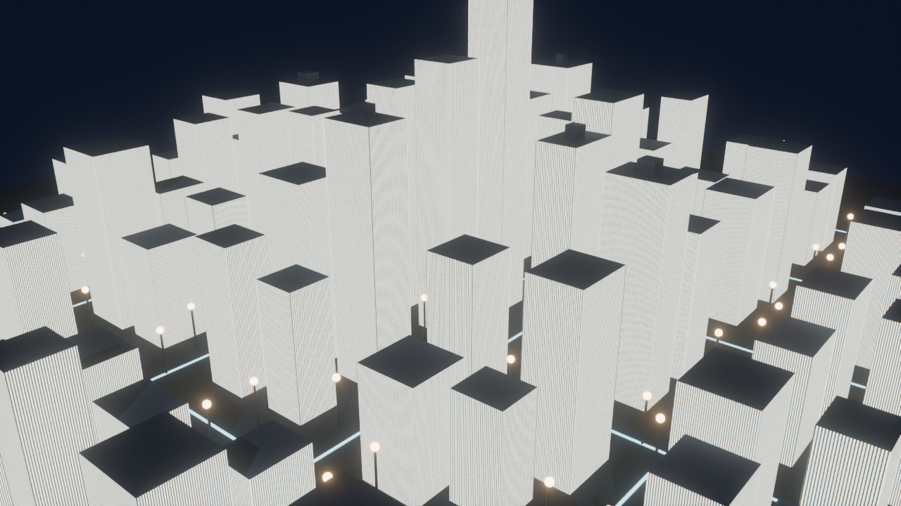

# voxel-city

Procedural night-time "cyberpunk" city block generator for Blender, run headless from a single Python script.



## What it does

`generate.py` uses Blender's Python API (`bpy`) to build a scene from scratch:

- A 5 × 5 grid of city blocks (30 m blocks, 12 m streets), each with four box-shaped towers. Towers get taller toward the centre ("downtown falloff").
- A procedural building material with emissive window grids.
- Glowing lane strips along every street, plus street lamps (pole + glowing head) on both sides.
- Rooftop boxes on some tall towers and red beacon lights on the tallest ones.
- A dark blue night sky, a soft sun and a large area light, and a fixed camera looking at the centre of the city.
- Cycles (CPU) rendering at 1280 × 720, 64 samples with denoising, and a fog-glow compositor pass for a subtle bloom.

The random seed is fixed (`SEED = 80`), so every run produces the same city.

## Requirements

- [Blender](https://www.blender.org/download/) 3.x or 4.x (it ships with its own Python and `bpy`; nothing to pip-install).

## Usage

```bash
blender --background --python generate.py
```

Outputs, written next to `generate.py`:

| File | Contents |
|---|---|
| `voxel_city.blend` | The generated scene, which you can open in Blender |
| `renders/city_preview.png` | The rendered preview image |

Rendering on CPU can take several minutes depending on your machine.

## Tweaking

Edit the constants at the top of `generate.py`:

| Constant | Default | Meaning |
|---|---|---|
| `SEED` | `80` | Random seed for building sizes/placement |
| `N_BLOCKS` | `5` | Blocks per side |
| `BLOCK` / `STREET` | `30.0` / `12.0` | Block size and street width (Blender units) |
| `SAMPLES` | `64` | Cycles render samples |
| `RES_X`, `RES_Y` | `1280`, `720` | Output resolution |
